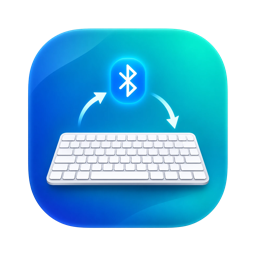
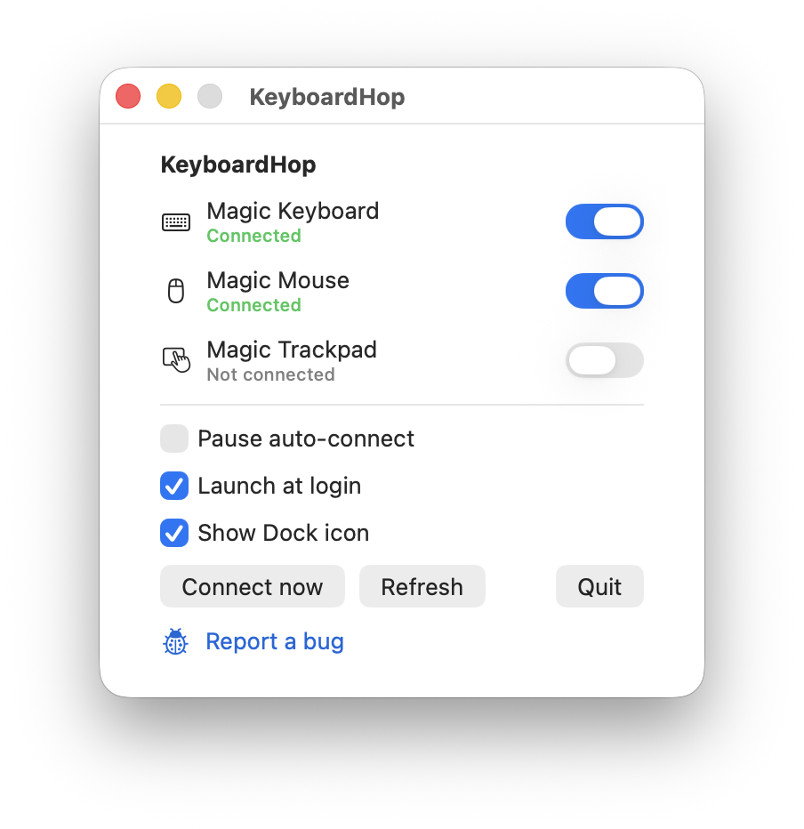
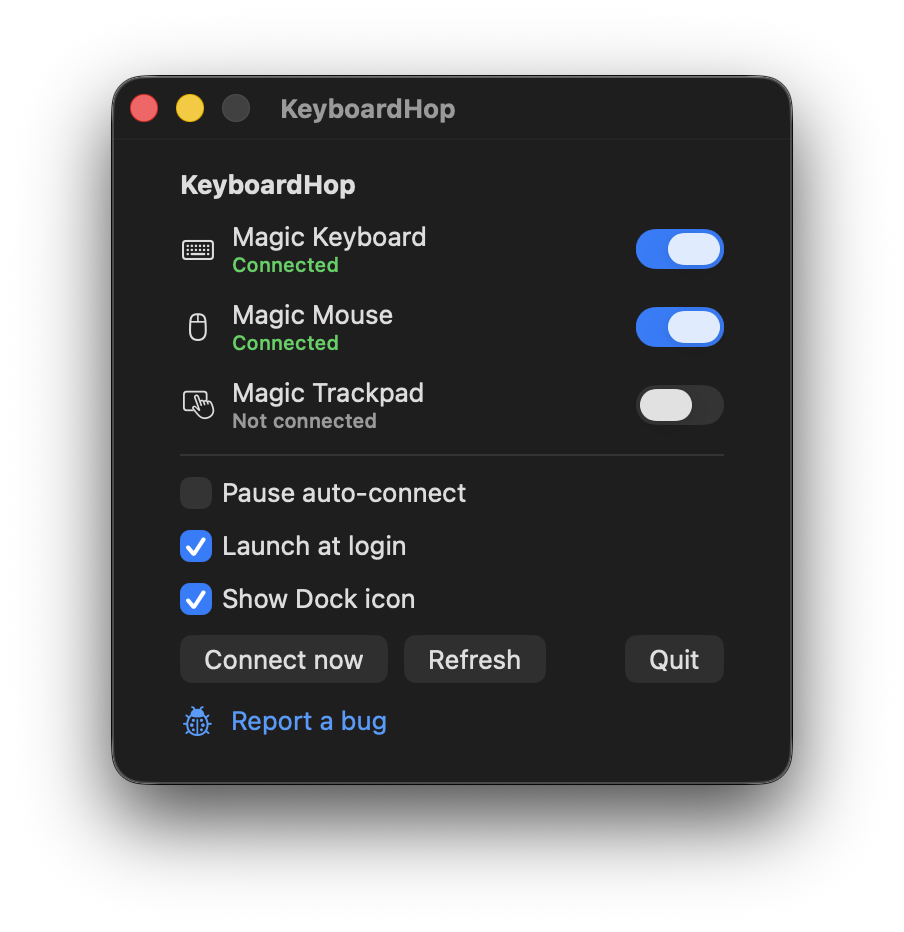

<p align="center">
  
</p>

<h1 align="center">KeyboardHop</h1>

<p align="center">
  A tiny macOS menu bar app that reconnects your Bluetooth keyboard, mouse or trackpad the moment it becomes available, so switching a Magic Keyboard from your desktop (USB) back to your MacBook (Bluetooth) just works.
</p>

<p align="center">
  <a href="https://keyboardhop.fxtstudio.app"><b>Website</b></a> &middot;
  <a href="https://github.com/felixt-io/KeyboardHop/releases/latest"><b>Download</b></a> &middot;
  <a href="https://github.com/felixt-io/KeyboardHop/issues/new"><b>Report a bug</b></a>
</p>

<p align="center">
  
  
</p>
<p align="center"><sub>Screenshots use sample device names.</sub></p>

## Magic Keyboard and two computers

The Apple Magic Keyboard is built to be used with one computer at a time. Unlike many Logitech and other multi-device keyboards, it has no device-switch button, so Apple does not offer a built-in way to move it between two computers. If you plug it into one machine by USB and then want it on another over Bluetooth, you are left waiting for the connection to come back on its own.

KeyboardHop adds that missing piece. Unplug the keyboard from one computer and it reconnects to your Mac over Bluetooth right away, which makes sharing one Magic Keyboard between two machines practical.

## Why I built this

I share one Magic Keyboard between a desktop and a MacBook. On the desktop it runs over USB. When I unplug it and move to the MacBook, it should fall back to Bluetooth, but in practice there was a noticeable wait every time before the keyboard worked again. Multiplied by many switches a day, that adds up to real friction.

## What macOS can't do on its own

In my experience, macOS has no setting that says "actively grab this specific device as soon as it shows up". It relies on the device and the system to retry the connection eventually, and you can't choose which paired devices should be reclaimed immediately. KeyboardHop fills that gap: you pick the devices, and it connects them right away.

## Who it helps

- Desktop plus laptop users sharing one keyboard or mouse (USB on one machine, Bluetooth on the other)
- Docking and hot-desking setups
- Anyone whose keyboard or mouse drops off after sleep or charging

## Features

- Pick any paired Bluetooth device from a list, with a per-device on/off switch
- Reconnects on disconnect, on wake from sleep, and every half second while idle
- Menu bar status icon, plus a Dock icon (on by default, can be switched off) so the app is always easy to find
- Launch at login (on by default, can be switched off)
- Pause switch, a "Connect now" button, and a "Report a bug" button that opens a prefilled GitHub issue
- Low power use: no polling while the Mac is asleep

## Install

1. Download the latest `.dmg` from [Releases](https://github.com/felixt-io/KeyboardHop/releases/latest) and drag the app to Applications.
2. The app is not notarized yet, so the first time right-click it and choose Open.
3. Allow the Bluetooth permission prompt.
4. Click the menu bar icon and switch on your devices.

## Build from source

Needs the Xcode Command Line Tools (no full Xcode required):

```bash
./scripts/build.sh
```

Output goes to `dist/`.

## Things to be aware of

- The device must already be paired with your Mac in System Settings > Bluetooth.
- KeyboardHop cannot force a device that is actively connected to another computer over Bluetooth to switch.
- Requires macOS 13 or later.
- On first launch the app adds itself to your login items so it keeps working after a restart. Turn this off with the "Launch at login" switch.
- If you use another tool that also reconnects devices (a script, Logi Options+ reconnect features), run only one to avoid conflicts.

## Troubleshooting

- No devices listed: pair them in System Settings > Bluetooth first, then click Refresh.
- Never connects: check System Settings > Privacy & Security > Bluetooth and allow KeyboardHop.

## Disclaimer

Apple, Mac, macOS, Magic Keyboard, Magic Mouse and Magic Trackpad are trademarks of Apple Inc., registered in the U.S. and other countries. The Bluetooth word mark is a registered trademark owned by Bluetooth SIG, Inc. KeyboardHop is an independent project by fxtstudio. It is not affiliated with, sponsored by, or endorsed by Apple Inc. or Bluetooth SIG, Inc. Product names are used for identification and compatibility purposes only. KeyboardHop is provided "as is", without warranty of any kind, and its authors are not liable for any damages arising from its use, as set out in the [MIT License](LICENSE).
